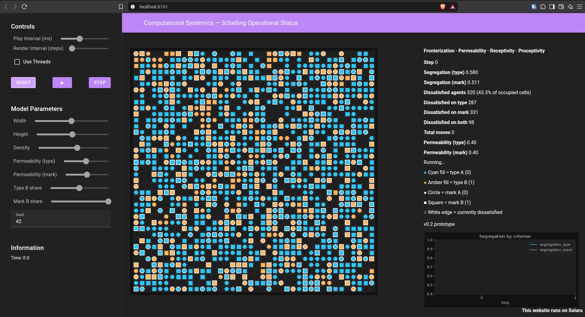
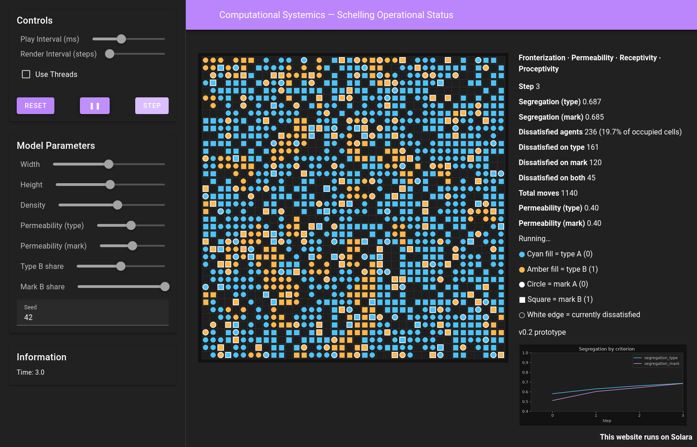
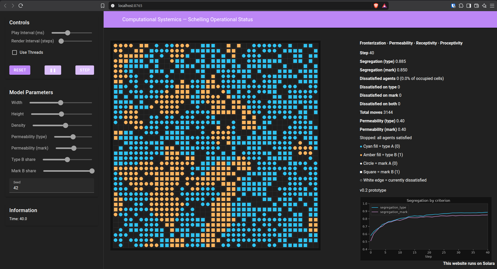

# Dashboard visual guidelines

Shared look for Computational Systemics dashboards. v0.1 is the reference.
A later model adds a channel, a stat, or a series on top of this page. It
does not invent a new visual system.

The v0.1 visualization spec remains the contract for that repository. These
guidelines are the cross-version rules. A version spec states only what that
version adds. When the two disagree about a shared rule, these guidelines win
and the version spec should be updated to match.

Reference captures from the running v0.2 dashboard in this folder:







The one-criterion page is the v0.1 dashboard. Its captures live in
`schelling-v0.1/docs/` as `solara-start.png` and `solara-end.png`. v0.2
keeps that page and adds the mark channel: marker shape, the second
permeability, the breach lines, and the second chart series.

## What stays

The page is one local Solara app. Viewers meet it in a browser on this
machine, or in a stream or a recording. The site links to the repository. It
does not embed the model.

Keep this skeleton:

1. **App bar.** Title: **Computational Systemics — Schelling Operational Status**. Solara's dark theme and its default bar. Do not set a custom primary color.
2. **Sidebar.** Three cards, in this order: Controls, Model Parameters, Information. Play, pause, step, and reset are Mesa's `ModelController`. The play-interval default is 200 ms.
3. **Main pane.** `solara.Columns([13, 7])`. The grid takes the wide column. The stats sit above the chart in the narrow column.

The field is near-black. Agents are high-contrast and the same size. Vacancies are the empty cells, visible because the cell borders are faint. Clustering should read at a glance on a 1080p stream.

The stats panel opens with the operator line:

```text
Fronterization · Permeability · Receptivity · Proceptivity
```

Then the reading order is: step, segregation, dissatisfied agents (count and percent of occupied cells), total moves, the permeability values, and either `Running…` or `Stopped: all agents satisfied`. The legend follows. A small footer names the version (`v0.1 prototype`, `v0.2 prototype`).

The chart sits under the stats on the same dark panel. Its y-axis runs up to 1 and includes a floor at 0.4, dropped only when a series goes below that. Step 0 is on the x-axis without collapsing the scale.

No gradients, glow, particles, or a second theme. Padding stays consistent with the v0.1 page. Matplotlib draws the grid to an image, so a hover tooltip is unavailable. The legend in the stats panel carries the mapping.

## Palette

| Role | Value |
| --- | --- |
| Page background | `#121212` |
| Grid background | `#1E1E1E` |
| Cell border | `#3A3A3A` |
| Fronterization 0 | `#4FC3F7` cyan |
| Fronterization 1 | `#FFB74D` amber |
| Receptivity firing | edge `#F5F5F5`, linewidth about 1.4 |
| Satisfied edge | `#2A2A2A`, linewidth about 0.4 |
| First chart series | `#4FC3F7` |
| Second chart series | `#CE93D8` |
| Chart and stat text | light gray on the dark panel, as in the captures |

Cyan and amber stay the two Fronterization colors. A new criterion does not take a new hue. The second chart color is reserved so it is not read as amber.

A third series, or any further color, is chosen in that version's spec before the dashboard is coded.

## Channels

Use channels in this order. Later versions inherit the earlier ones.

| Channel | Meaning in v0.1 | Still means |
| --- | --- | --- |
| Fill color | The one criterion, `type` | Fronterization on the first criterion. Cyan is 0. Amber is 1. |
| Edge | Receptivity firing | Dissatisfied right now, whichever entry fired. |
| Marker shape | Unused. Every agent is a circle. | The second criterion. Circle is 0. Square is 1. Same scatter area as the circle. |

v0.2 is the first user of the shape channel. Its spec has the legend text and the two series.

Do not encode a criterion by size, transparency, or a ring of extra colors. Those reads fail at 40×40.

## What a version may add

- Legend rows for a channel that version turns on.
- Stat rows for measures that version logs.
- Chart series, with a legend once there is more than one. v0.1 removes the legend because it has one series.
- The slider set for that version's parameters.
- The version footer.

A different page layout is a spec decision, made when this skeleton cannot show the new measure. The dashboard code does not invent that layout on its own. Until a spec says otherwise, new models use the skeleton above.

## Implementation constraints

These keep the page on screen. They are part of the look.

- Mesa 3.5.1 with the visualization extra, Matplotlib through `SpaceRenderer`. The constructor is keyword-only.
- `StatusSpaceRenderer` calls `setup_structure` and `setup_agents`, and sets `post_process` to the dark grid style. Reset builds a new renderer with `type(renderer)(model, backend)`, so the style has to live on the class.
- `agent_portrayal` returns an `AgentPortrayalStyle`.
- The stats panel is one `solara.HTML` widget whose body is replaced in place. `solara.Markdown` builds a new widget every step, the text vanishes for a frame, and the chart jumps.
- Do not move the grid, the stats, or the chart into `SolaraViz`. Its `GridDraggable` never mounts on this Solara build, because vue-grid-layout calls `window.Vue.use` and that function is absent.
- The dashboard is local. Do not add a hosted Solara target.

Launch from the version folder with `./setup.sh`, or `solara run app.py` inside that folder's `.venv`.
